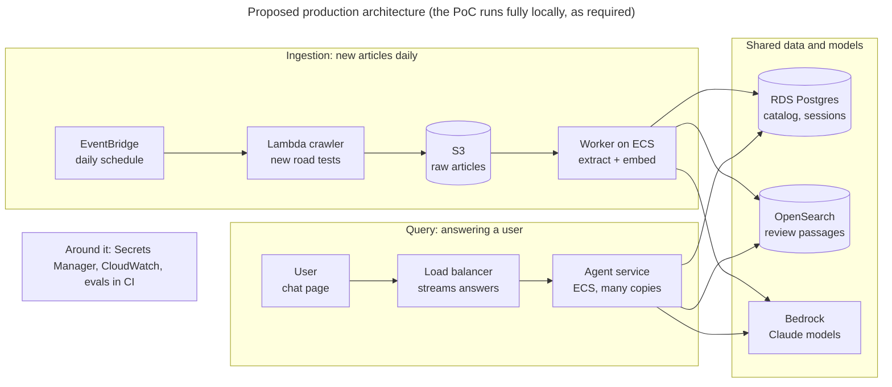

# Proposed production architecture (the PoC runs fully locally, as required)

This is how the product would run on AWS. The PoC does not use it. The PoC stays one process on this machine.

In the PoC, everything lives in one process on one machine. In production, the app keeps no data of its own: the catalog and conversations live in Postgres and the review text in a search engine, so the agent can run as several copies, and new articles arrive by themselves.

## Ingestion

New articles arrive on their own, which is how the catalog grows past a handful of reviews. EventBridge runs once a day and starts a Lambda crawler that finds new auto.co.il road tests. The crawler stores the raw articles in S3. A worker on ECS reads that bucket, extracts cars, prices, and roles with Bedrock, rebuilds aliases, and writes embeddings. The catalog goes to RDS Postgres. The passages go to OpenSearch. The "add a review" button drops a file into the same S3 bucket, so a hand-added article takes the same path.

## Query

A person uses the chat page. A load balancer streams the answer back. The agent service runs as several copies on ECS. A copy reads the catalog and the conversation from Postgres, searches passages in OpenSearch, and calls Claude through Bedrock. The reply is a streamed answer with sources.

## Around it

Secrets Manager holds passwords. CloudWatch holds logs, latency, tokens and cost per turn, and validator rejections. Evals run in CI before every release.

## What moves where

| Local | Production | Why |
| --- | --- | --- |
| SQLite catalog | RDS Postgres | Several copies of the agent need one shared catalog. |
| SQLite checkpoints (conversations) | RDS Postgres | The next turn may land on a different copy, so the conversation cannot stay inside one process. |
| Chroma + BM25 in the process | OpenSearch | Vector search and keyword search live in one place, which is what the retrieval comparison measured. |
| Anthropic API | Bedrock (Claude) | The same model, called from inside the AWS account. |
| Manual ingest by URL | Scheduled crawler → S3 → worker | A daily job finds new road tests instead of someone pasting each URL. |
| The local web process | Agent service on ECS behind a load balancer | One local process cannot serve many people or stream from several copies. |
| JSON traces on the terminal | CloudWatch | Each model call and tool call is already one JSON line. Those lines become the service logs. |

## Trade-offs

- OpenSearch gives real BM25 plus vectors, matching what we evaluated. pgvector is simpler to run, and its full-text search is not BM25.
- Bedrock keeps Claude traffic inside the AWS account, with IAM instead of API keys.
- Open question: Hebrew support in the search analyzer still has to be checked. The local BM25 tokenizer strips Hebrew prefixes, and a default analyzer may not.
